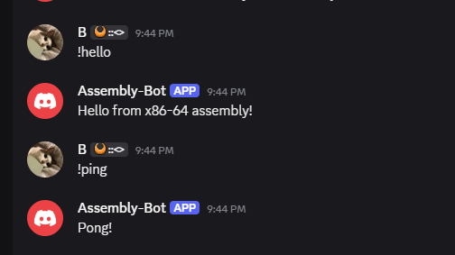

# Assembly-Bot


After a horrible 6 months, I am finally done with this bot

This is a discord bot written fully in x86-64 assembly (for windows, maybe I'll port this to linux soon and/or other architectures)

this also makes heavy use of winhttp, simply because handling TLS from scratch would hurt me mentally, badly. I probably *could* do the websocket framing myself, but then again, why not choose the simpler way out? Anyways, instructions on how to use this are below

## Commands

 Command  | Reply                                  
 ----------|----------------------------------------
 `!ping`  | `Pong! Gateway latency: N ms`          
 `!hello` | A greeting from the bot       

To add a command, write a handler that builds a JSON body. Then add a row to the `commands` table in `src/bot.asm`

## Setup

1. Create an application at <https://discord.com/developers/applications>
2. On the **Bot** tab, reset and copy the token
3. On the same tab, enable **Message Content Intent**
4. Under **OAuth2 > URL Generator**, select the `bot` scope with the **View Channels** and **Send Messages** permissions. Open the generated URL to invite the bot

## Build and run

Building requires NASM, the windows SDK, and `lld-link` or MSVC `link`

```powershell
.\build.bat
$env:TOKEN = "your-bot-token"
.\build\assembly-bot.exe
```

